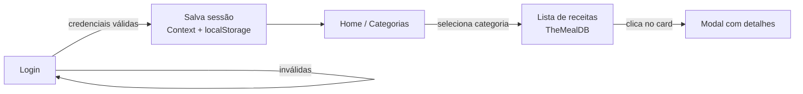

<h1 align="center">🍽️ Savory</h1>
 
<p align="center">
  <strong>SPA em React para explorar receitas por categoria, consumindo a API pública TheMealDB.</strong>
</p>
<p align="center">
  <a href="https://supermoduloreact.com"><strong>🔗 Ver demo ao vivo</strong></a>
  ·
  <a href="#-como-rodar-localmente">Rodar localmente</a>
  ·
  <a href="#-autor">Contato</a>
</p>
<p align="center">
  
  
  
  
  
</p>
<p align="center">
  
</p>
---
 
## 📌 Resumo
 
O **Savory** é uma aplicação front-end que simula a experiência de um cardápio digital: o usuário faz login, navega pelas categorias de receitas e abre os detalhes de cada prato (ingredientes, modo de preparo e imagem) em um modal.
 
O foco do projeto foi praticar **arquitetura de componentes, roteamento SPA, estado global e consumo de API REST** em React, com deploy contínuo no GitHub Pages.
 
## 🎯 Destaques técnicos
 
| O que | Como foi feito |
|---|---|
| **Consumo de API REST** | Requisições assíncronas (`fetch` + `async/await`) à TheMealDB para listar categorias, receitas e detalhes |
| **Estado global** | `UserContext` (Context API) compartilha o usuário logado entre páginas, sem prop drilling |
| **Roteamento SPA** | React Router DOM v7 com rotas para login, cadastro, home e "sobre" |
| **Persistência de sessão** | Usuário salvo no `localStorage`, mantendo a sessão ao recarregar a página |
| **Componentização** | Componentes reutilizáveis (`Card`, `Header`, `Footer`, `IngredientList`, `HeroInputField`) separados de páginas |
| **UI responsiva** | Layout em cards adaptado para mobile, tablet e desktop |
| **Build e deploy** | Vite para build + `gh-pages` com script `predeploy` automatizando a publicação |
 
> ℹ️ A autenticação é **simulada**: as credenciais são validadas contra um JSON local (`public/usuarios.json`). O objetivo foi praticar o fluxo de login/sessão no front-end, não segurança de back-end.
 
## ✨ Funcionalidades
 
- 🔐 Login com validação de e-mail e senha
- 💾 Sessão persistida no `localStorage`
- 🗂️ Navegação por categorias de receitas
- 🃏 Listagem de pratos em cards responsivos
- 🔎 Modal com detalhes completos da receita
- 🌐 Deploy online com domínio próprio
## 🧭 Fluxo da aplicação
 

 
## 🗂️ Estrutura
 
```
src/
├── components/      # Componentes reutilizáveis (Card, Header, Footer, LoginForm...)
│   └── css/         # Estilos por componente
├── context/
│   └── userContext.jsx   # Estado global do usuário
├── pages/           # Telas roteadas (hero, main, register, about)
├── utils/           # Endpoints da API
├── App.js           # Definição das rotas
└── index.js         # Entry point
```
 
## 🚀 Como rodar localmente
 
**Pré-requisitos:** Node.js 18+ e npm
 
```bash
# 1. Clone o repositório
git clone https://github.com/DevWizardMarcos/ReactSavory-.git
cd ReactSavory-
 
# 2. Instale as dependências
npm install
 
# 3. Rode em modo de desenvolvimento
npm run dev
```
 
Acesse `http://localhost:5173`.
 
| Script | O que faz |
|---|---|
| `npm run dev` | Servidor de desenvolvimento (Vite) |
| `npm run build` | Build de produção em `dist/` |
| `npm run preview` | Pré-visualiza o build |
| `npm run deploy` | Builda e publica no GitHub Pages |
 
## 🔌 API
 
Dados fornecidos pela [TheMealDB](https://www.themealdb.com/api.php) — API pública e gratuita de receitas.
 
## 🛣️ Próximos passos
 
- [ ] Busca de receitas por nome
- [ ] Favoritos salvos por usuário
- [ ] Estados de loading e erro nas requisições
- [ ] Testes com React Testing Library
- [ ] Migração para TypeScript
## 👨‍💻 Autor
 
**Marcos Simões** — Desenvolvedor Front-end · Belo Horizonte, MG
 
<p>
  <a href="https://portifolinodev.vercel.app"></a>
  <a href="https://github.com/DevWizardMarcos"></a>
  <a href="https://www.linkedin.com/in/SEU-LINKEDIN"></a>
</p>
 
